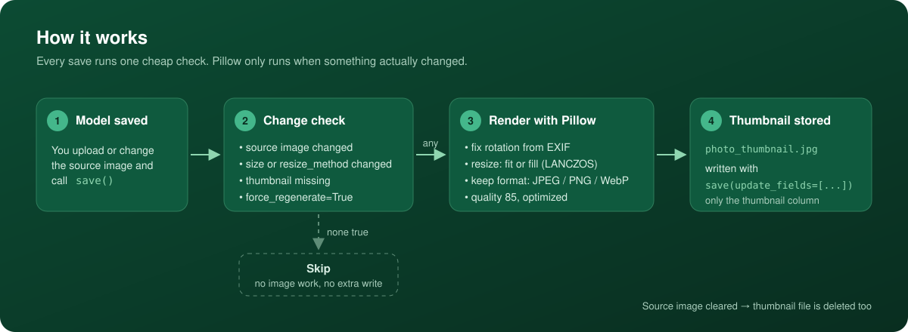
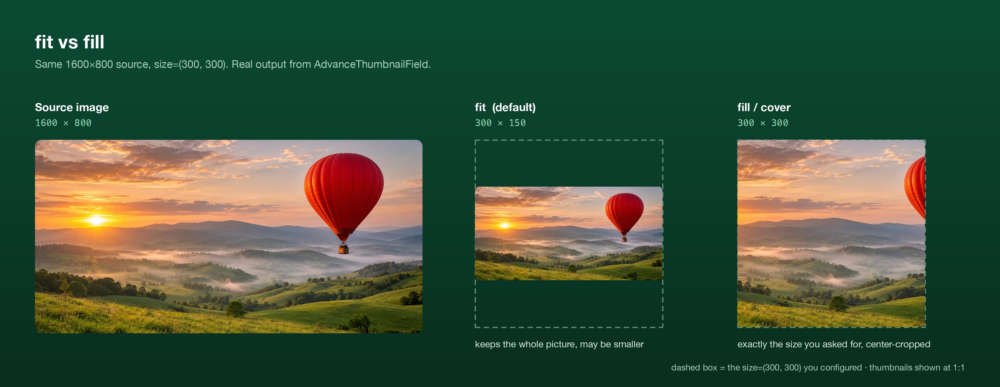

<p align="center">
  
</p>

<h1 align="center">Django Advance Thumbnail</h1>

<p align="center">
  <strong>Thumbnails as a model field.</strong> Declare it once, and every save keeps the thumbnail in sync with its source image.
</p>

<p align="center">
  <a href="https://github.com/itsmahadi007/django_advance_thumbnail/actions/workflows/tests.yml"></a>
  <a href="https://pypi.org/project/django-advance-thumbnail/"></a>
  <a href="https://pypi.org/project/django-advance-thumbnail/"></a>
  <a href="https://pypi.org/project/django-advance-thumbnail/"></a>
  <a href="https://pepy.tech/project/django-advance-thumbnail"></a>
  <a href="https://github.com/itsmahadi007/django_advance_thumbnail/blob/main/LICENSE"></a>
</p>

<p align="center">
  <a href="#installation">Installation</a> ·
  <a href="#quick-start">Quick start</a> ·
  <a href="#how-it-works">How it works</a> ·
  <a href="#resize-methods">Resize methods</a> ·
  <a href="#management-commands">Commands</a> ·
  <a href="#production-notes">Production notes</a>
</p>

---

## Why this library

Most thumbnail tools render on request, from template tags. `AdvanceThumbnailField` instead stores the thumbnail as a **real `ImageField`** on your model, generated once at save time. That means:

- `product.thumbnail.url` works everywhere: templates, the admin, DRF serializers, any storage backend or CDN.
- No image processing on page views, and no template tags to learn.
- The thumbnail follows its source: it is created on save, rebuilt when the source changes, and deleted when the source is cleared.

**Pick this library** when each image needs one or a few fixed thumbnail sizes, known up front, that you want stored next to the original.
**Pick something else** when sizes are chosen in templates or per request (sorl-thumbnail, easy-thumbnails), or when you need processing pipelines such as filters and watermarks (django-imagekit).

> **Using an AI coding assistant?** Point it at [`llms.txt`](https://github.com/itsmahadi007/django_advance_thumbnail/blob/main/llms.txt), a one-page integration guide with the exact steps, options and gotchas.

## Features

| | |
|---|---|
| **Automatic** | Generated on `post_save`. No signals or tasks to write. |
| **Smart regeneration** | Rebuilt only when the source, `size` or `resize_method` changes, or the thumbnail is missing. |
| **Two resize modes** | `fit` keeps the whole picture. `fill` returns exact dimensions by center-cropping. |
| **Format aware** | Keeps JPEG, PNG and WebP (transparency included). Fixes rotation from EXIF. |
| **Thread safe** | Safe under gunicorn, uWSGI and other multi-threaded servers (v2.0+). |
| **Bulk tools** | `generate_thumbnails` and `regenerate_thumbnails` management commands. |
| **Migration friendly** | Full `deconstruct()` support, so field settings appear in migrations. |

## Installation

```bash
pip install django-advance-thumbnail
```

Add the app to `INSTALLED_APPS`:

```python
INSTALLED_APPS = [
    # ...
    "django_advance_thumbnail",
]
```

## Quick start

```python
from django.db import models
from django_advance_thumbnail import AdvanceThumbnailField


class Product(models.Model):
    image = models.ImageField(upload_to="products/")
    thumbnail = AdvanceThumbnailField(
        source_field="image",
        upload_to="thumbnails/",
        size=(300, 300),
        null=True,
        blank=True,
    )
```

Run `makemigrations` and `migrate`. Every saved `Product` now gets a thumbnail:

```html

```

> Adding the field to a model that already has rows? Run `python manage.py generate_thumbnails` once to backfill.

## How it works

<p align="center">
  
</p>

The thumbnail is saved as `<source name>_thumbnail<ext>` with `save(update_fields=[...])`, so only the thumbnail column is written back to the database.

## Resize methods

<p align="center">
  
</p>

| Method | Result for a 1600×800 source at `size=(300, 300)` | Use it for |
|---|---|---|
| `fit` *(default)* | **300×150**. The whole image, scaled to fit inside the box. | Galleries and previews where nothing may be cut off |
| `fill` / `cover` | **300×300**. Scaled to cover the box, then center-cropped. | Grids, avatars and cards that need identical sizes |

```python
from django_advance_thumbnail import AdvanceThumbnailField, RESIZE_FIT, RESIZE_FILL

thumbnail = AdvanceThumbnailField(source_field="image", size=(300, 300), resize_method=RESIZE_FILL)
```

`cover` is an alias for `fill`. The constants `RESIZE_FIT`, `RESIZE_FILL` and `RESIZE_COVER` are exported for convenience.

## Field options

| Option | Type | Default | Description |
|---|---|---|---|
| `source_field` | `str` | **required** | Name of the `ImageField` to build the thumbnail from |
| `size` | `tuple[int, int]` | `(300, 300)` | Target `(width, height)` in pixels |
| `resize_method` | `str` | `"fit"` | `"fit"`, `"fill"` or `"cover"` |
| `force_regenerate` | `bool` | `False` | Rebuild on every save, even when nothing changed |

All standard `ImageField` options (`upload_to`, `storage`, `null`, `blank`, …) work as usual. Invalid options raise `ImproperlyConfigured` at startup, not at runtime.

### Several thumbnails per image

```python
class Product(models.Model):
    image = models.ImageField(upload_to="products/")

    # Small, whole image, for listings
    thumbnail_small = AdvanceThumbnailField(
        source_field="image", upload_to="thumbnails/small/",
        size=(100, 100), resize_method="fit", null=True, blank=True,
    )

    # Large, exact size, for the detail page
    thumbnail_large = AdvanceThumbnailField(
        source_field="image", upload_to="thumbnails/large/",
        size=(400, 400), resize_method="fill", null=True, blank=True,
    )
```

## Management commands

**`generate_thumbnails`** creates missing thumbnails. Use it after adding the field to existing data.

```bash
python manage.py generate_thumbnails                         # every model
python manage.py generate_thumbnails --model shop.Product    # one model
python manage.py generate_thumbnails --model shop.Product --field thumbnail
python manage.py generate_thumbnails --force                 # rebuild existing ones too
python manage.py generate_thumbnails --dry-run               # preview only
```

**`regenerate_thumbnails`** rebuilds thumbnails after you change `size` or `resize_method`.

```bash
python manage.py regenerate_thumbnails                 # rebuild where the config changed
python manage.py regenerate_thumbnails --force         # rebuild everything
python manage.py regenerate_thumbnails --clear-cache   # forget cached config first
python manage.py regenerate_thumbnails --dry-run       # preview only
```

Both commands accept `--model app_label.ModelName` and `--field name`.

## Production notes

**Change detection.** The cache is only a fast path. On a cache miss (a restart, an eviction, or a per-process backend such as `LocMemCache`), the field compares the stored thumbnail name with the current source instead. So restarts and extra workers do not produce duplicate thumbnails.

That fallback only sees filenames. If you replace a source file **under the same name** and you have no shared cache (Redis, Memcached), the change is not detected. Run `regenerate_thumbnails --force` in that case.

**Config changes.** After changing `size` or `resize_method`, run `regenerate_thumbnails`. Existing rows are not rebuilt until they are saved again.

**Thread safety.** Since v2.0, recursion is prevented with an instance-level flag instead of disconnecting and reconnecting signals. This makes the field safe under multi-threaded servers.

**Formats.** JPEG, PNG and WebP sources keep their format. Other formats are encoded as JPEG, and transparent images are placed on a white background when saved as JPEG.

## Requirements

- Python 3.6+
- Django 3.0+
- Pillow 8.0+

Every push is tested in CI on Python 3.9 – 3.14, Django 3.2 – 6.x and Pillow 8.4 – latest. See [CHANGELOG.md](https://github.com/itsmahadi007/django_advance_thumbnail/blob/main/CHANGELOG.md) for release notes.

## Upgrading from 1.x

Version 2.0 makes `source_field` required, validates options at startup and changes the return value of `regenerate_thumbnails()`. See [MIGRATION_GUIDE.md](https://github.com/itsmahadi007/django_advance_thumbnail/blob/main/MIGRATION_GUIDE.md).

## Contributing

Issues and pull requests are welcome.

```bash
git clone https://github.com/itsmahadi007/django_advance_thumbnail.git
cd django_advance_thumbnail
pip install -r requirements.txt
pytest
```

## Author

**Mahadi Hassan**: [mahadihassan.com](https://mahadihassan.com) · [GitHub](https://github.com/itsmahadi007) · [LinkedIn](https://linkedin.com/in/mahadi-hassan-4a2239154/) · [mh@mahadihassan.com](mailto:mh@mahadihassan.com)

## License

[MIT](https://github.com/itsmahadi007/django_advance_thumbnail/blob/main/LICENSE)
